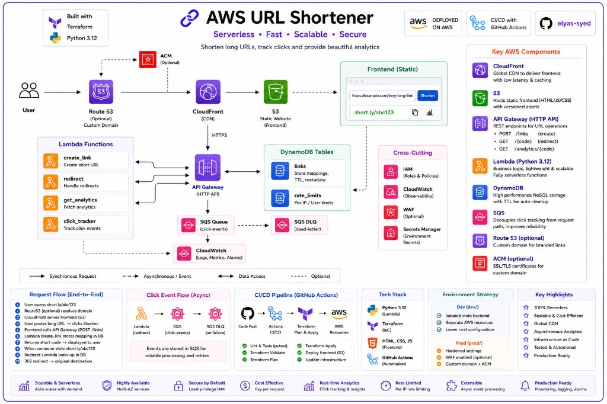
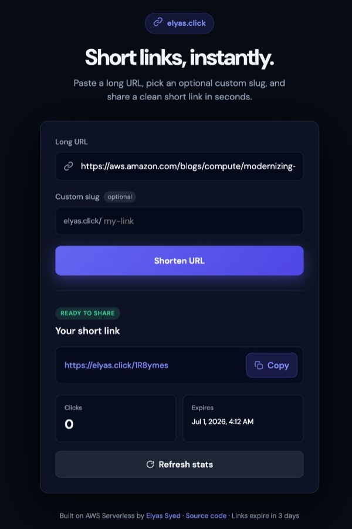
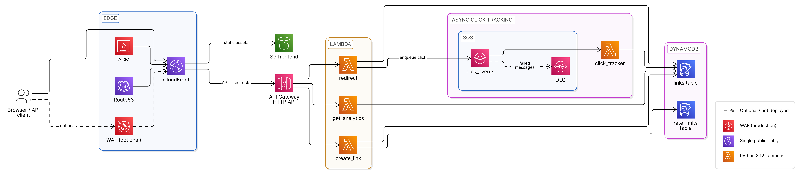

# AWS URL Shortener

**Short links. Zero servers. Built on AWS.**

A deployable, production-grade serverless URL shortener with a web UI, REST API, click analytics, and link expiration — no servers to manage. Built with Terraform, Lambda, DynamoDB, SQS, API Gateway, CloudFront, and S3.

**[Documentation](docs/README.md)** · Terraform · Python 3.12 · Serverless

<p align="center">
  
</p>

<p align="center">
  
</p>

## Features

- Shorten URLs via web UI or REST API
- Custom slugs and link expiration (default **3 days**, DynamoDB TTL)
- Async click analytics via SQS
- Demo mode: open create API with 5 requests/min/IP rate limit
- Optional custom domain, API key auth, and AWS WAF (see [Optional configuration](#optional-configuration))

## Architecture

<p align="center">
  
</p>

Request flows, data model, CloudFront routing, and design rationale: [docs/architecture.md](docs/architecture.md).

## Quick start

### Prerequisites

- AWS account with credentials configured
- Terraform >= 1.10 (required for S3 native state lockfile)
- Python 3.12+
- `make`, `zip`

### 1. Bootstrap remote state (one time)

```bash
cd terraform/bootstrap
cp terraform.tfvars.example terraform.tfvars
# Edit state_bucket_name to a globally unique value
terraform init
terraform apply
```

Copy the `backend_config` output into the `backend "s3"` block in `terraform/versions.tf` (uses `use_lockfile = true` instead of DynamoDB), then:

```bash
cd ../
terraform init
```

### 2. Build Lambda packages

```bash
make build
make test
```

### 3. Deploy

```bash
cd terraform
cp terraform.tfvars.example terraform.tfvars
terraform plan
terraform apply
```

Note the `app_url` output — that is your public shortener URL.

### 4. Try it

**Browser:** open `app_url`, paste a URL, click Shorten.

**Terminal:**

```bash
chmod +x scripts/demo.sh
./scripts/demo.sh "$(terraform -chdir=terraform output -raw app_url)"
```

Custom domain setup, updates, and CloudFront invalidation: [docs/deployment.md](docs/deployment.md).

## API at a glance

| Method | Path | Description |
|--------|------|-------------|
| POST | `/api/links` | Create a short link |
| GET | `/api/links/{slug}` | Link metadata and click count |
| DELETE | `/api/links/{slug}` | Soft-delete (requires `api_key` auth) |
| GET | `/{slug}` | Redirect to long URL |
| HEAD | `/{slug}` | Redirect headers only |
| GET | `/health` | Health check |

```bash
curl -X POST "$APP_URL/api/links" \
  -H "Content-Type: application/json" \
  -d '{"url":"https://example.com","slug":"demo"}'
```

Full request/response schemas, validation rules, and error codes: [docs/api.md](docs/api.md).

## Optional configuration

Set these in `terraform/terraform.tfvars` (see [terraform.tfvars.example](terraform/terraform.tfvars.example)).

| Variable | Default | Purpose | Details |
|----------|---------|---------|---------|
| `auth_mode` | `open` | API key auth for create/delete | [security.md](docs/security.md) |
| `domain_name` | `""` | Custom domain via Route53 + ACM | [deployment.md](docs/deployment.md) |
| `enable_waf` | `false` | Edge rate limiting on CloudFront (~$5+/month) | [cost.md](docs/cost.md) · [security.md](docs/security.md) |
| `default_link_ttl_days` | `3` | Default link expiration | [architecture.md](docs/architecture.md) |

## Cost

~**$1–2/month** at demo traffic. Enabling WAF adds ~**$5+/month** minimum. Breakdown and scaling factors: [docs/cost.md](docs/cost.md).

## Project layout

```
terraform/          Root stack and modules
src/                Python Lambda handlers
web/                Static frontend
docs/               Detailed guides (architecture, API, deployment, …)
assets/images/      Screenshots and architecture diagram (PNG)
tests/              Unit tests
scripts/demo.sh     End-to-end demo script
```

## Documentation

| Document | Description |
|----------|-------------|
| [Architecture](docs/architecture.md) | System design, request flows, and data model |
| [API reference](docs/api.md) | REST endpoints, schemas, and error codes |
| [Deployment](docs/deployment.md) | Bootstrap, deploy, custom domain, and runbook |
| [Security](docs/security.md) | Auth modes, validation, rate limits, and hardening |
| [Terraform](docs/terraform.md) | Module layout, variables, and extension guide |
| [Operations](docs/operations.md) | Monitoring, troubleshooting, and day-2 tasks |
| [Development](docs/development.md) | Local build, test, and contribution workflow |
| [Cost](docs/cost.md) | Estimated monthly spend and scaling factors |
| [Roadmap](docs/roadmap.md) | Planned features and known gaps |

## Contributing

Feature branches and pull requests welcome. See [docs/development.md](docs/development.md) for the full workflow.
