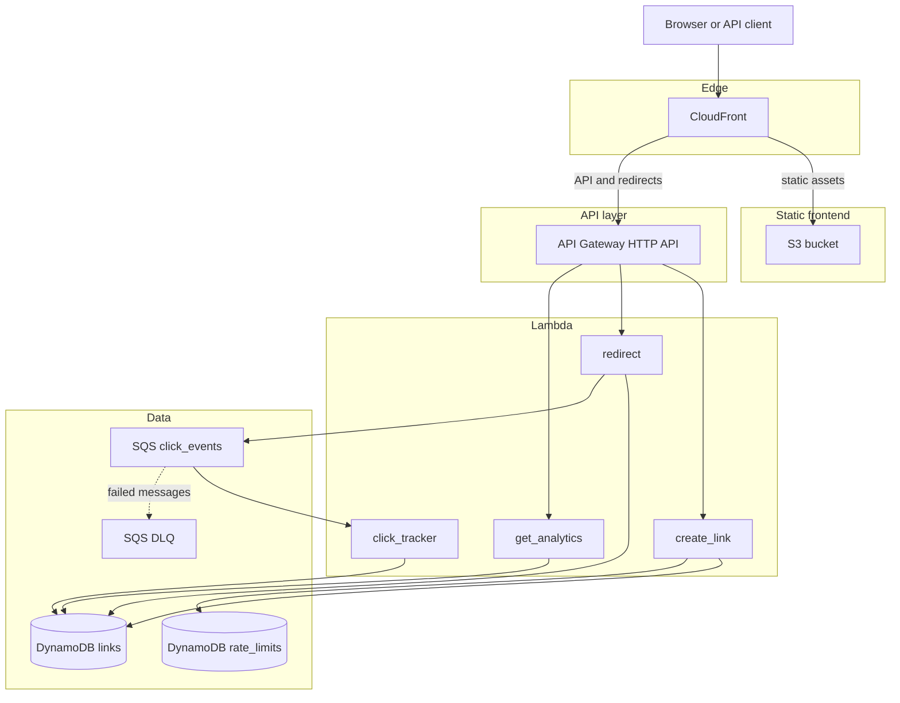

# Architecture

## Overview

The URL shortener is a single-environment, serverless application on AWS. CloudFront is the only public entry point. It routes traffic to either a static S3 frontend or API Gateway, which invokes Python Lambdas backed by DynamoDB and SQS.

Static paths (`/`, `/assets/*`, `/index.html`) go to S3. API paths (`/api/*`, `/health`) and short links (`/{slug}`) go to API Gateway — see [CloudFront routing](#cloudfront-routing) below.

## Request flows

### Create short link

1. Client sends `POST /api/links` through CloudFront to API Gateway.
2. `create_link` Lambda validates JSON, URL, and optional slug.
3. In `auth_mode = "open"`, a per-IP rate limit is checked in the `rate_limits` DynamoDB table.
4. A new item is written to the `links` table with `expires_at` for TTL.
5. Response returns `short_url`, `slug`, and metadata.

### Redirect

1. Client requests `GET /{slug}` (or `HEAD /{slug}`).
2. CloudFront matches the `/*` cache behavior and forwards to API Gateway.
3. `redirect` Lambda loads the link, checks expiration and `is_active`.
4. A click event is enqueued to SQS (non-blocking).
5. Client receives an HTTP 302 to the long URL.

### Click analytics (async)

1. `click_tracker` Lambda is triggered by SQS in batches (up to 10 messages).
2. Each message increments `click_count` on the link item.
3. Failed processing retries up to 3 times, then messages land in the DLQ.

### Get link metadata

1. Client sends `GET /api/links/{slug}`.
2. `get_analytics` Lambda returns link details including `click_count` and `expired` flag.

## CloudFront routing

CloudFront path patterns determine which origin handles a request:

| Path pattern | Origin | Purpose |
|--------------|--------|---------|
| Default (`/`) | S3 | Landing page |
| `/assets/*` | S3 | CSS, JS |
| `/index.html` | S3 | Explicit HTML |
| `/api/*` | API Gateway | REST API (no cache) |
| `/health` | API Gateway | Health check (no cache) |
| `/*` | API Gateway | Short-link redirects |

The catch-all `/*` behavior must come after static paths so `/api/links` and `/assets/app.js` are not treated as slugs.

## Data model

### `links` table

| Attribute | Type | Description |
|-----------|------|-------------|
| `slug` | String (PK) | Short identifier |
| `long_url` | String | Destination URL |
| `created_at` | String | ISO 8601 timestamp |
| `expires_at` | Number | Unix epoch; DynamoDB TTL attribute |
| `click_count` | Number | Total clicks |
| `is_active` | Boolean | Soft-delete flag |

### `rate_limits` table

| Attribute | Type | Description |
|-----------|------|-------------|
| `client_ip` | String (PK) | Client IP from `X-Forwarded-For` or API Gateway |
| `request_count` | Number | Requests in current window |
| `window_start` | Number | Start of 60-second window |
| `expires_at` | Number | TTL for automatic cleanup |

## Components

| Component | Technology | Role |
|-----------|------------|------|
| Frontend | S3 + static HTML/JS | Web UI for shortening URLs |
| Edge | CloudFront | TLS, routing, caching |
| API | API Gateway HTTP API | REST + redirect routes |
| Compute | Lambda (Python 3.12) | Business logic |
| Storage | DynamoDB on-demand | Links and rate limits |
| Messaging | SQS + DLQ | Decoupled click tracking |
| DNS / TLS | Route53 + ACM (optional) | Custom domain |

## Bootstrap stack

Remote Terraform state lives in a separate bootstrap stack under `terraform/bootstrap/`. It provisions an encrypted, versioned S3 bucket with native lockfile support (`use_lockfile = true`). See [Deployment](deployment.md) and [ADR 001](architecture-decisions.md#adr-001-s3-native-lockfile-over-dynamodb-state-locking).
